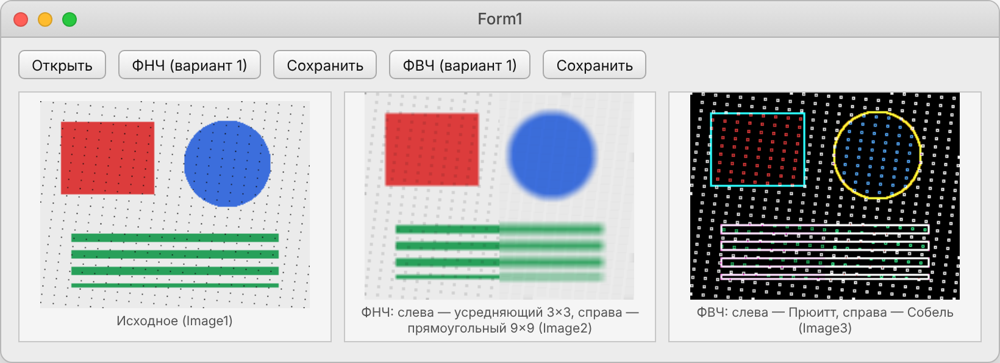

# Лабораторная работа №7. Введение в фильтрацию изображений

**Дисциплина:** Компьютерная графика
**Среда разработки:** Lazarus IDE (Free Pascal Compiler)
**Вариант 1:**
- ФНЧ: к левой половине изображения применить ФНЧ №1 (усредняющий), к правой — ФНЧ №2 (прямоугольный).
- ФВЧ: к левой половине изображения применить ФВЧ Прюитт, к правой — ФВЧ Собела.

## Задание

1. Разработать алгоритм и программу, выполняющую: загрузку изображения из файла; обработку изображения свёрточным фильтром низких частот (ФНЧ) по заданию варианта; обработку изображения свёрточным фильтром высоких частот (ФВЧ) по заданию варианта; сохранение результатов в файл.
2. Ответить на контрольные вопросы.
3. Оформить отчёт.

## Программа

Форма содержит:

| Компонент | Имя | Назначение |
|---|---|---|
| TImage | `Image1` | исходное изображение |
| TImage | `Image2` | результат ФНЧ |
| TImage | `Image3` | результат ФВЧ |
| TButton | `ButtonLoad` | "Открыть" |
| TButton | `ButtonLowPass` | "ФНЧ (вариант 1)" |
| TButton | `ButtonSaveLowPass` | сохранение результата ФНЧ |
| TButton | `ButtonHighPass` | "ФВЧ (вариант 1)" |
| TButton | `ButtonSaveHighPass` | сохранение результата ФВЧ |

Вся фильтрация реализована как **дискретная свёртка** изображения с ядром (матрицей) фильтра: для каждого пикселя результата окно пикселей исходного изображения (размера ядра) поэлементно перемножается с ядром, произведения суммируются, сумма делится на нормирующий коэффициент (сумму весов ядра) и ограничивается диапазоном [0, 255]. Чтобы при свёртке изображение не "сжималось" по краям (методичка описывает эту проблему как краевой эффект), крайние пиксели за границей изображения **дублируются** (clamp) — простой и распространённый способ её смягчения.

Используемые ядра (взяты из таблицы матриц свёртки методички):

```
ФНЧ №1, "Усредняющий" 3×3 (норм. 9):      ФНЧ №2, "Прямоугольный" 9×9 (норм. 81):
1 1 1                                      все веса = 1 (более широкое окно
1 1 1                                      усреднения => более сильное размытие)
1 1 1

ФВЧ "Прюитт" (норм. 1):                    ФВЧ "Собель" (норм. 1):
верт.        гориз.                        верт.         гориз.
-1 -1 -1    -1 0 1                        -1 -2 -1      -1 0 1
 0  0  0    -1 0 1                         0  0  0      -2 0 2
 1  1  1    -1 0 1                         1  2  1      -1 0 1
```

Для ФВЧ по каждому цветовому каналу вычисляется модуль градиента `sqrt(Gверт² + Gгориз²)` — стандартный способ получить из двух направленных ядер (вертикального и горизонтального) один результат, показывающий границы независимо от их ориентации.

Ключевой фрагмент — универсальная свёртка пикселя произвольным ядром (конкретные ядра ФНЧ/ФВЧ и обработчики кнопок — в полном коде ниже):

```pascal
procedure ConvolvePixel(src: TBitmap; x, y, w, h: Integer;
  const kernel: array of array of real; ksize: Integer; norm: real;
  out rr, gg, bb: real);
var
  di, dj, half: Integer;
  c: TColor;
  kv: real;
begin
  rr := 0;
  gg := 0;
  bb := 0;
  half := ksize div 2;
  for di := -half to half do
    for dj := -half to half do
    begin
      c := GetPixelClamped(src, x + dj, y + di, w, h);
      kv := kernel[di + half][dj + half];
      rr := rr + kv * GetRValue(c);
      gg := gg + kv * GetGValue(c);
      bb := bb + kv * GetBValue(c);
    end;
  rr := rr / norm;
  gg := gg / norm;
  bb := bb / norm;
end;
```

<details>
<summary>Показать полный код Unit1.pas</summary>

```pascal
unit Unit1;

{$mode objfpc}{$H+}

interface

uses
  Classes, SysUtils, Forms, Controls, Graphics, Dialogs, ExtDlgs, ExtCtrls,
  StdCtrls, LCLIntf, LCLType, Math;

type

  { TForm1 }

  TForm1 = class(TForm)
    ButtonLoad: TButton;
    ButtonLowPass: TButton;
    ButtonSaveLowPass: TButton;
    ButtonHighPass: TButton;
    ButtonSaveHighPass: TButton;
    Label1: TLabel;
    Image1: TImage;
    Image2: TImage;
    Image3: TImage;
    OpenPictureDialog1: TOpenPictureDialog;
    SavePictureDialog1: TSavePictureDialog;
    procedure ButtonLoadClick(Sender: TObject);
    procedure ButtonLowPassClick(Sender: TObject);
    procedure ButtonSaveLowPassClick(Sender: TObject);
    procedure ButtonHighPassClick(Sender: TObject);
    procedure ButtonSaveHighPassClick(Sender: TObject);
  private
  public
  end;

var
  Form1: TForm1;

implementation

{$R *.lfm}

{ TForm1 }

function ConvertTo24Bit(aValue: TBitmap): TBitmap;
begin
  Result := TBitmap.Create;
  if aValue.PixelFormat <> pf24bit then
  begin
    Result.PixelFormat := pf24bit;
    Result.SetSize(aValue.Width, aValue.Height);
    Result.Canvas.Draw(0, 0, aValue);
  end
  else
    Result.Assign(aValue);
end;

// считывание пикселя с "продлением" граничных пикселей наружу,
// чтобы изображение после свёртки не теряло размер (как сказано в методичке)
function GetPixelClamped(bmp: TBitmap; x, y, w, h: Integer): TColor;
begin
  if x < 0 then x := 0;
  if x >= w then x := w - 1;
  if y < 0 then y := 0;
  if y >= h then y := h - 1;
  Result := bmp.Canvas.Pixels[x, y];
end;

// свёртка одного пикселя (x,y) ядром kernel размера ksize x ksize (нечётным),
// с делением результата на norm. Возвращает по отдельности R, G, B (ещё без обрезки).
procedure ConvolvePixel(src: TBitmap; x, y, w, h: Integer;
  const kernel: array of array of real; ksize: Integer; norm: real;
  out rr, gg, bb: real);
var
  di, dj, half: Integer;
  c: TColor;
  kv: real;
begin
  rr := 0;
  gg := 0;
  bb := 0;
  half := ksize div 2;
  for di := -half to half do
    for dj := -half to half do
    begin
      c := GetPixelClamped(src, x + dj, y + di, w, h);
      kv := kernel[di + half][dj + half];
      rr := rr + kv * GetRValue(c);
      gg := gg + kv * GetGValue(c);
      bb := bb + kv * GetBValue(c);
    end;
  rr := rr / norm;
  gg := gg / norm;
  bb := bb / norm;
end;

function ClampByte(v: real): byte;
begin
  if v < 0 then
    Result := 0
  else if v > 255 then
    Result := 255
  else
    Result := round(v);
end;

procedure TForm1.ButtonLoadClick(Sender: TObject);
var
  tmp: TBitmap;
begin
  if OpenPictureDialog1.Execute then
  begin
    Image1.Picture.LoadFromFile(OpenPictureDialog1.FileName);
    if Image1.Picture.Bitmap.PixelFormat <> pf24bit then
    begin
      tmp := ConvertTo24Bit(Image1.Picture.Bitmap);
      Image1.Picture.Bitmap.Assign(tmp);
      tmp.Free;
    end;
    Image1.Stretch := True;
    Image1.Proportional := True;
  end;
end;

// ---------------------------------------------------------------------
// Вариант 1, ФНЧ: к левой половине изображения применяем ФНЧ №1
// (усредняющий 3х3, табл.1 методички), к правой половине - ФНЧ №2
// (прямоугольный - блочный фильтр большего размера, 9х9, все веса = 1).
// ---------------------------------------------------------------------
procedure TForm1.ButtonLowPassClick(Sender: TObject);
const
  Averaging3x3: array[0..2, 0..2] of real = (
    (1, 1, 1),
    (1, 1, 1),
    (1, 1, 1));
var
  Rect9x9: array of array of real;
  i, j, w, h: Integer;
  rr, gg, bb: real;
begin
  if Image1.Picture.Graphic = nil then
  begin
    ShowMessage('Сначала загрузите изображение!');
    Exit;
  end;

  w := Image1.Picture.Bitmap.Width;
  h := Image1.Picture.Bitmap.Height;

  SetLength(Rect9x9, 9, 9);
  for i := 0 to 8 do
    for j := 0 to 8 do
      Rect9x9[i][j] := 1;

  Image2.Picture.Bitmap.PixelFormat := pf24bit;
  Image2.Picture.Bitmap.SetSize(w, h);

  for i := 0 to w - 1 do
    for j := 0 to h - 1 do
    begin
      if i < w div 2 then
        ConvolvePixel(Image1.Picture.Bitmap, i, j, w, h, Averaging3x3, 3, 9, rr, gg, bb)
      else
        ConvolvePixel(Image1.Picture.Bitmap, i, j, w, h, Rect9x9, 9, 81, rr, gg, bb);
      Image2.Picture.Bitmap.Canvas.Pixels[i, j] :=
        RGB(ClampByte(rr), ClampByte(gg), ClampByte(bb));
    end;

  Image2.Stretch := True;
  Image2.Proportional := True;
  Image2.Invalidate;
end;

procedure TForm1.ButtonSaveLowPassClick(Sender: TObject);
begin
  if SavePictureDialog1.Execute then
    Image2.Picture.SaveToFile(SavePictureDialog1.FileName);
end;

// ---------------------------------------------------------------------
// Вариант 1, ФВЧ: к левой половине применяем дифференцирующий фильтр
// Прюитт, к правой - Собель (ядра по вертикали и горизонтали из табл.1
// методички), результат - модуль градиента sqrt(Gv^2+Gh^2) по каждому каналу.
// ---------------------------------------------------------------------
procedure TForm1.ButtonHighPassClick(Sender: TObject);
const
  PrewittV: array[0..2, 0..2] of real = (
    (-1, -1, -1),
    (0, 0, 0),
    (1, 1, 1));
  PrewittH: array[0..2, 0..2] of real = (
    (-1, 0, 1),
    (-1, 0, 1),
    (-1, 0, 1));
  SobelV: array[0..2, 0..2] of real = (
    (-1, -2, -1),
    (0, 0, 0),
    (1, 2, 1));
  SobelH: array[0..2, 0..2] of real = (
    (-1, 0, 1),
    (-2, 0, 2),
    (-1, 0, 1));
var
  i, j, w, h: Integer;
  rrV, ggV, bbV, rrH, ggH, bbH: real;
  rr, gg, bb: real;
begin
  if Image1.Picture.Graphic = nil then
  begin
    ShowMessage('Сначала загрузите изображение!');
    Exit;
  end;

  w := Image1.Picture.Bitmap.Width;
  h := Image1.Picture.Bitmap.Height;

  Image3.Picture.Bitmap.PixelFormat := pf24bit;
  Image3.Picture.Bitmap.SetSize(w, h);

  for i := 0 to w - 1 do
    for j := 0 to h - 1 do
    begin
      if i < w div 2 then
      begin
        ConvolvePixel(Image1.Picture.Bitmap, i, j, w, h, PrewittV, 3, 1, rrV, ggV, bbV);
        ConvolvePixel(Image1.Picture.Bitmap, i, j, w, h, PrewittH, 3, 1, rrH, ggH, bbH);
      end
      else
      begin
        ConvolvePixel(Image1.Picture.Bitmap, i, j, w, h, SobelV, 3, 1, rrV, ggV, bbV);
        ConvolvePixel(Image1.Picture.Bitmap, i, j, w, h, SobelH, 3, 1, rrH, ggH, bbH);
      end;
      rr := sqrt(sqr(rrV) + sqr(rrH));
      gg := sqrt(sqr(ggV) + sqr(ggH));
      bb := sqrt(sqr(bbV) + sqr(bbH));
      Image3.Picture.Bitmap.Canvas.Pixels[i, j] :=
        RGB(ClampByte(rr), ClampByte(gg), ClampByte(bb));
    end;

  Image3.Stretch := True;
  Image3.Proportional := True;
  Image3.Invalidate;
end;

procedure TForm1.ButtonSaveHighPassClick(Sender: TObject);
begin
  if SavePictureDialog1.Execute then
    Image3.Picture.SaveToFile(SavePictureDialog1.FileName);
end;

end.
```

</details>

## Результат работы программы



*Рис. 1 – Исходное изображение (фигуры с резкими границами + мелкий точечный "шум" для наглядности фильтрации); результат ФНЧ (слева — слабое размытие усредняющим фильтром 3×3, справа — сильное размытие прямоугольным фильтром 9×9: точечный шум практически пропал, но и границы фигур стали заметно более размытыми); результат ФВЧ (слева — Прюитт, справа — Собель: в обоих случаях на чёрном фоне остались только контуры фигур и точки шума — частотный фильтр подавил всё, кроме резких перепадов яркости, что и ожидается от фильтра высоких частот).*

## Как запустить

1. Создать новый проект Application в Lazarus.
2. Разместить на форме компоненты по таблице выше с точными именами.
3. Вставить код `Unit1.pas` целиком, привязать `OnClick` каждой кнопки.
4. На macOS при ошибке линковщика добавить `-WM10.9` в Custom Options.
5. Запустить: "Открыть" → "ФНЧ (вариант 1)" → "ФВЧ (вариант 1)" → при необходимости сохранить каждый результат.

## Вывод

Реализована свёрточная фильтрация изображений двумя классами фильтров: ФНЧ (усредняющий и прямоугольный — оба сглаживают изображение и подавляют шум, но ценой размытия границ объектов; чем больше размер ядра, тем сильнее эффект) и ФВЧ (Прюитт и Собель — операторы градиента, оставляющие в изображении только резкие перепады яркости, т.е. границы объектов, и подавляющие однородные области). Собель, за счёт весовых коэффициентов 2 у центральных элементов ядра, даёт немного более гладкий и менее шумный результат выделения границ по сравнению с Прюиттом, у которого все веса одинаковы.
